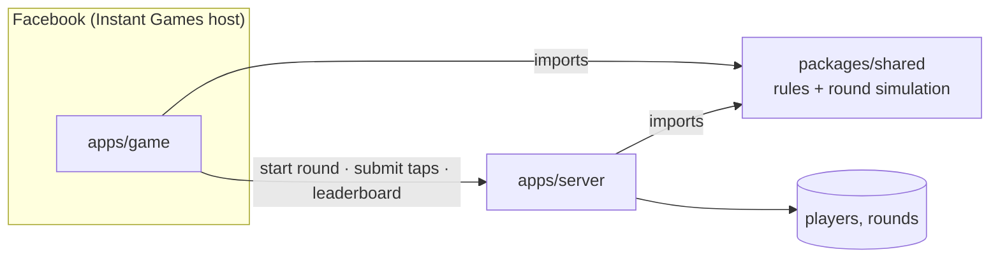

<p align="center">
  
</p>

<h1 align="center">Glowcatch</h1>

<p align="center"><strong>Tap Rush, reimagined.</strong> Thirty seconds of dusk. Tap the fireflies before their light fades.</p>

---

Glowcatch is a Facebook Instant Game with its own leaderboard backend. It's an exercise brief, **Tap Rush**, rebuilt around a theme: every shrinking circle is a firefly whose light is fading, and you catch it with a tap.

> **Status:** design complete, build in progress on the [`development`](https://github.com/JhnChrstnMabuhayTech/tap-rush-game/tree/development) branch. `main` holds the reviewed, deployable state. Progress: [roadmap](docs/roadmap.md).

| | |
| --- | --- |
| **Play** | `https://www.facebook.com/gaming/play/<APP_ID>/` (staged for testing; link added once the app exists) |
| **Backend** | Public HTTPS URL added once deployed |
| **Design** | [docs/design](docs/design/) |

## How it plays

- **A round is 30 seconds**, after a 3-2-1-Go countdown. Fireflies appear, shrink as their light fades, and a tap catches one.
- **The pace builds with you.** The round opens gently and speeds up as you score, through three phases: Dusk, Night falls and Midnight.
- **Combos multiply.** Catch 5 in a row for ×2 points, 10 for ×3. Let a firefly fade and the combo resets. The sky warms while your streak lasts.
- **Three bonus fireflies**, each with its own shape: **Lantern** (+5), **Frost** (stops the clock for 3 s) and **Swarm** (six quick fireflies).
- **Game over** shows your score, best, rank, top combo and fireflies caught, with Share, Play again and the top 10.

Full rules: [docs/design/gameplay.md](docs/design/gameplay.md).

## The brief, and how Glowcatch meets it

| The brief asks for | Glowcatch |
| --- | --- |
| A 30-second round; circles appear and shrink; a tap scores | Fireflies appear and fade. Each catch scores, multiplied by the combo. Game over also shows **Caught**, the plain one-per-firefly count ([D3](docs/decisions.md#d3-combo-multiplier-and-bonus-fireflies-on-top-of-the-core-scoring)). |
| Game over: score, best, Share with an image, Play again, top-10 leaderboard | The game-over sheet has all of these, plus rank, top combo and fireflies caught. The share image is a 1200×630 score card. |
| Works with touch and mouse, on phone and desktop | One `pointerdown` handler with multi-touch. Full-screen on phones; a 9:16 frame, letterboxed, on desktop. |
| Best score kept between sessions | Saved on the device and in the player's Facebook game data, reconciled on launch ([D8](docs/decisions.md#d8-best-score-in-three-places)). |
| Design matters; rename and theme it | A complete design system: night palette, one typeface, glow instead of shadow, an animated title, a High contrast theme. |
| Creativity, keeping the core gameplay | Score-driven pace, combos and bonus fireflies on top of an unchanged appear-shrink-tap loop. |
| A backend that only accepts scores it can trust | Facebook-signed player identity, server-issued rounds, and a server-side replay of every round from its seed ([trust model](docs/trust-model.md)). |
| Runs on Facebook, staged for testing only | Uploaded to Instant Games Web Hosting and moved to Testing. Never pushed to Production or submitted for review. |
| Game and backend in one repository | `apps/game`, `apps/server` and `packages/shared` in one pnpm workspace. |

## Architecture



The game and the server import the same rules and round simulation. That's what lets the server replay a round and compute the score itself, instead of trusting a number from the client. Details: [docs/architecture.md](docs/architecture.md).

## How scores are trusted

1. **Who is playing.** Every request carries a signature from Facebook's `getSignedPlayerInfoAsync`, which the server checks with the app's secret. Nobody can submit a score for a player without playing as that player inside the game on Facebook.
2. **Which round.** The server issues each round with its own ID and random seed. A score is only accepted for a round the server issued to that player, once, within its time limit.
3. **What happened.** The client sends its taps, not just a score. The server replays the round from the seed with the same rules code and works out the score itself. A score the replay can't reproduce isn't ranked.

A bot that plays the real game perfectly would still replay correctly; no client-side game can fully stop that. Plausibility checks (reaction time, tap rate) and stored tap logs make it harder and visible. Every threat and check: [docs/trust-model.md](docs/trust-model.md).

## Repository layout

```
apps/game/         Instant Game client (planned)
apps/server/       Leaderboard backend (planned)
packages/shared/   Rules and round simulation shared by both (planned)
docs/
  design/          Design system snapshot: brand, gameplay, states, components, tokens, logos
  architecture.md  How the parts fit together; a round end to end
  trust-model.md   What the backend checks, and what it can't stop
  decisions.md     Every significant choice and its trade-off; open questions
  roadmap.md       Build order and progress
```

## Tech stack (planned)

| Part | Choice | Why |
| --- | --- | --- |
| Game | TypeScript, Canvas 2D, plain DOM, the Glowcatch UI kit | Small bundle, fast load inside Facebook, no engine overhead ([D5](docs/decisions.md#d5-plain-typescript-with-canvas-and-dom-no-game-engine-or-framework)) |
| Build | Vite, pnpm workspaces | Fast dev server with HTTPS for testing in Facebook's embedded player |
| Backend | Cloudflare Workers + D1 (proposed) | Free, HTTPS, no cold starts, doesn't sleep during review ([D7](docs/decisions.md#d7-host-the-backend-on-cloudflare-workers-with-d1)) |
| Tests | Vitest | Shared by all three packages |
| CI | GitHub Actions | Lint, type-check and test on every push |

## Getting started

Setup instructions arrive with the code in Phase 1 of the [roadmap](docs/roadmap.md). You'll need Node.js 20+, pnpm, and for the backend a Cloudflare account. Testing inside Facebook needs a Meta developer account with a role on the app.

## How this was built

This is an AI-first project. The design system was built with Claude (Cowork); the code is built with Claude Code. Every choice an agent made is reviewed and logged with its reasoning in [docs/decisions.md](docs/decisions.md), and gaps found during review are tracked in the [design review notes](docs/design/README.md#review-notes).
