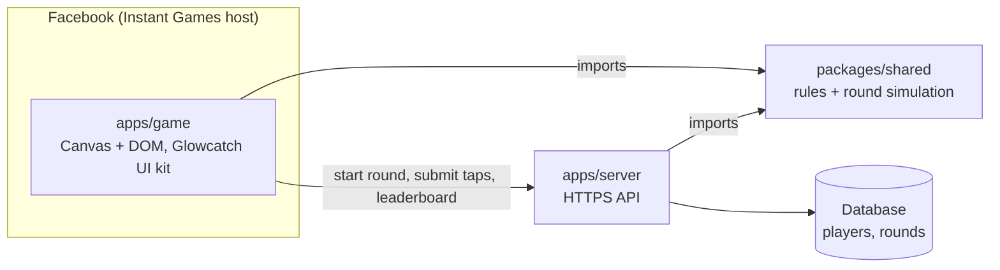
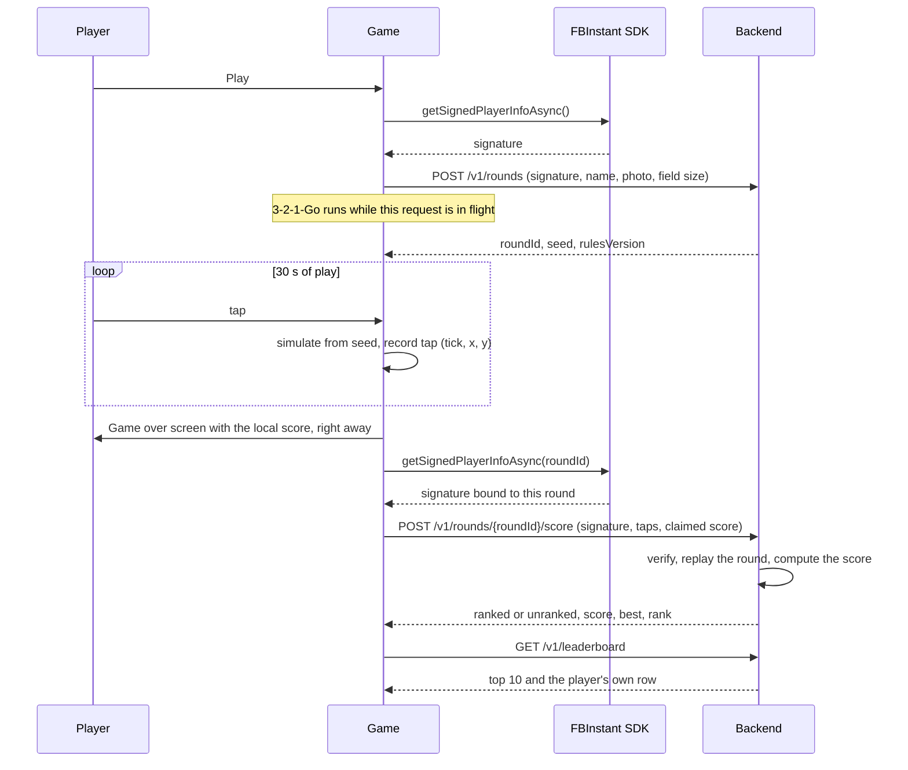

# Architecture

> **Status: draft.** Nothing here is built yet. This is the design the build starts from; it gets updated as code lands.

Glowcatch has two parts in one repo:

- **The game**: a Facebook Instant Game, plain TypeScript with Canvas and DOM, built on the Glowcatch UI kit.
- **The backend**: a small HTTPS API that issues rounds, checks scores and keeps the leaderboard.

They share one package, the **round simulation**. Because the server runs the same code as the game, it can replay a round from its seed and the player's taps and work out the score itself.



## Repository layout

```
apps/game/         The Instant Game: boot, screens, game loop, input, audio, API client
apps/server/       The leaderboard API
packages/shared/   Rules (curve, combo, bonuses), seeded random generator, round simulation, API types
docs/              Design snapshot, architecture, trust model, decisions, roadmap
```

## A round, end to end



If the round can't be started (offline, server down), the game still plays from a local random seed. The score is kept on the device and game over says "Score not ranked this round." Play is never blocked by the network.

## The game (`apps/game`)

| Module | Job |
| --- | --- |
| Boot | `FBInstant.initializeAsync`, real loading progress, `startGameAsync` once the title can render. Outside Facebook (local dev) a small mock stands in for the SDK. |
| Screens | A state machine over the flow in [design/states.md](design/states.md): title, how to play, countdown, play, paused, game over, leaderboard. |
| Game loop | Simulation at a fixed tick from `packages/shared`; drawing every animation frame with the kit's `drawField` and `drawFirefly`. |
| Input | One `pointerdown` handler for touch and mouse, multi-touch, coordinates converted to the simulation's logical units. |
| Audio | Chimes synthesised with Web Audio, unlocked on the first tap, mute remembered. |
| Best score | `localStorage` for an instant read, reconciled with `FBInstant.player` data; keep the higher. |
| API client | Timeouts, a retry queue for unsent scores, offline detection. |
| Share | `renderShareImage` → `FBInstant.shareAsync`; cancelling is not an error. |

## The backend (`apps/server`)

### Endpoints (draft)

| Method and path | Purpose |
| --- | --- |
| `POST /v1/rounds` | Verify the player's signature, create a round, return `roundId`, `seed`, `rulesVersion`, `expiresAt`. |
| `POST /v1/rounds/{roundId}/score` | Verify, replay, store. Returns `status` (`ranked` or `unranked`), the server's `score`, the player's `best` and `rank`. |
| `GET /v1/leaderboard?player={id}` | Top 10 by best score, plus the player's own row and rank when they're outside it. |
| `GET /health` | Liveness check for uptime monitoring. |

Every response that the player sees maps to a state in [design/states.md](design/states.md). A rejected score is reported as `unranked`, never as an accusation.

### Data (draft)

- **players**: `id` (Facebook player ID), `name`, `photo_url`, `best_score`, `best_at`, `updated_at`
- **rounds**: `id`, `player_id`, `seed`, `rules_version`, `field_w`, `field_h`, `issued_at`, `submitted_at`, `score`, `status` (`issued` · `ranked` · `rejected`), `reject_reason`

The leaderboard is a query on `players` ordered by `best_score` descending, then `best_at` ascending, so on a tie the earlier score lists first. Tied scores get the same rank number.

### Hosting (proposed)

Cloudflare Workers with a D1 (SQLite) database. It's free at this scale, served over HTTPS, has no cold start and doesn't go to sleep, which matters because the backend has to stay up through the review. The Facebook App Secret is stored as a Worker secret and never reaches the client bundle or the repo. See [decisions.md](decisions.md).

## The shared simulation (`packages/shared`)

The rules in [design/gameplay.md](design/gameplay.md) are ported from the UI kit into plain TypeScript here, so the game and the server can't disagree. For the server's replay to land on exactly the same score, the simulation has to be **deterministic**: same seed and same taps, same result, on every device and on the server.

| Rule | Why |
| --- | --- |
| Fixed tick; taps applied at tick boundaries | Frame rate (60 Hz vs 120 Hz, dropped frames) must not change the round. |
| Logical coordinates for the frame size captured at round start | Screen size must not change where fireflies spawn. A mid-round resize only rescales the drawing. |
| Full-precision seeded random generator, one stream, fixed draw order | Every decision draws the same numbers in the same order. |
| Game decisions use plain arithmetic only (no `Math.sin` or `Math.hypot`) | Engines may round those differently; drift that uses them is visual only. |
| A `rulesVersion` on every round | A rules change never breaks replay of rounds already in flight. |

The kit's own demo loop doesn't meet these rules yet; see the review notes in [design/README.md](design/README.md#review-notes).

How the server decides whether to trust a score is in [trust-model.md](trust-model.md).
