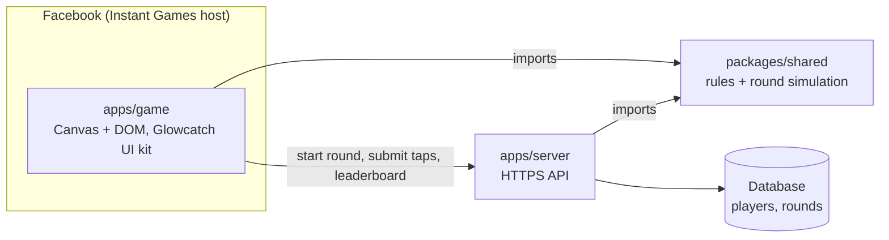
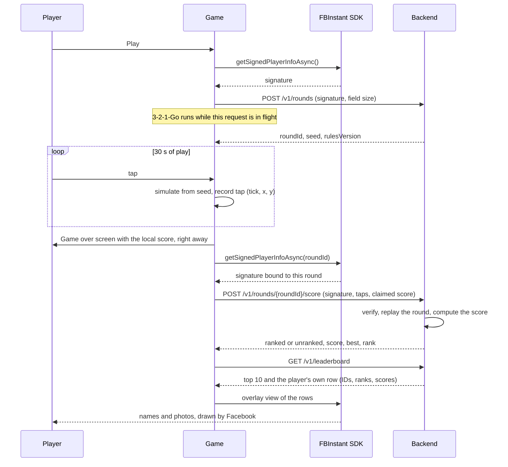

# Architecture

> **Status: in progress.** All three parts are scaffolded and tested in CI (roadmap Phase 1); the round simulation, the game loop and the API come next. The [frontend](frontend/) and [backend](backend/) docs mark what's built.

Glowcatch has two parts in one repo:

- **The game**: a Facebook Instant Game, plain TypeScript with Canvas and DOM, built on the Glowcatch UI kit.
- **The backend**: a small HTTPS API that issues rounds, checks scores and keeps the leaderboard.

They share one package, the **round simulation**. Because the server runs the same code as the game, it can replay a round from its seed and the player's taps and work out the score itself.



## Repository layout

```
apps/game/         The Instant Game: boot, screens, game loop, input, audio, API client
apps/server/       The leaderboard API
packages/shared/   Rules (curve, combo, bonuses), seeded random generator, round simulation, API types
docs/              Architecture, frontend/ (the game), backend/ (the server and trust model),
                   design snapshot, decisions, roadmap
```

## A round, end to end



If the round can't be started (offline, server down), the game still plays from a local random seed. The score is kept on the device and game over says "Score not ranked this round." Play is never blocked by the network.

## The game (`apps/game`)

Boot, screens, the game loop, input, audio, best score, the API client and sharing. Module by module, with how to run and upload it: [frontend/](frontend/).

## The backend (`apps/server`)

Endpoints, the data model and hosting, with how to run and deploy it: [backend/](backend/).

## The shared simulation (`packages/shared`)

The rules in [design/gameplay.md](design/gameplay.md) are ported from the UI kit into plain TypeScript here, so the game and the server can't disagree. For the server's replay to land on exactly the same score, the simulation has to be **deterministic**: same seed and same taps, same result, on every device and on the server.

| Rule | Why |
| --- | --- |
| Fixed tick; taps applied at tick boundaries | Frame rate (60 Hz vs 120 Hz, dropped frames) must not change the round. |
| Logical coordinates for the frame size captured at round start | Screen size must not change where fireflies spawn. A mid-round resize only rescales the drawing. |
| Full-precision seeded random generator, one stream, fixed draw order | Every decision draws the same numbers in the same order. |
| Game decisions use plain arithmetic only (no `Math.sin` or `Math.hypot`) | Engines may round those differently, and a firefly's position decides whether a tap hits. |
| A `rulesVersion` on every round | A rules change never breaks replay of rounds already in flight. |

### How it's built

| File | What it holds |
| --- | --- |
| `rules.ts` | The kit's rules as plain TypeScript: `pace`, `difficulty`, `comboFor`, `pointsFor`, `pickBonus`, and the `CURVE`, `PHASES` and `BONUSES` tables |
| `random.ts` | `createRandom(seed)`: mulberry32, integer operations only, 32 bits per draw |
| `curves.ts` | `wave()` (a sine within 0.1%, for drift) and `shrink()` (the design's life^0.7, sampled), from + − × ÷ only |
| `simulation.ts` | `Round`, which the game drives live, and `replayRound`, which the server runs on a tap log |

- **Ticks.** A tick is 10 ms, so a round is 3,000 ticks plus 300 for each freeze, at most 3,600. The game loop (next) will step as many ticks as real time allows each frame; `Round.step()` takes no time argument, so frame rate can't leak in.
- **Taps.** `Round.tap(x, y)` applies between ticks and logs `{ tick, x, y }`, where `tick` is the number of ticks completed. `replayRound` applies each tap before stepping that tick, which is exactly when the game applied it.
- **Units.** A round's `field` is `{ width, height, top }`: the play frame's CSS size at round start, and the HUD band (plus the safe-area inset) that nothing spawns above. The game will convert pointer positions into these units, and rescale its drawing if the frame changes mid-round.
- **Maths.** Positions, spacing and hit tests use `wave()`, `shrink()` and squared distances. ESLint rejects engine-dependent maths, `**`, clocks and unseeded randomness anywhere in `packages/shared/src`.
- **Events.** `step()` and `tap()` return what happened (`spawn`, `catch`, `fade`, `streak-lost`, `phase`, `end`), so the game drives sound, bursts and banners from the same source of truth.

Tests replay 40 rounds played with jittery frame batching and get the live result every time. A second test fails if the kit's copy of the rules drifts from this one. Choices and trade-offs: [D13](decisions.md#d13-how-the-simulation-stays-replayable).

How the server decides whether to trust a score is in [backend/trust-model.md](backend/trust-model.md).
